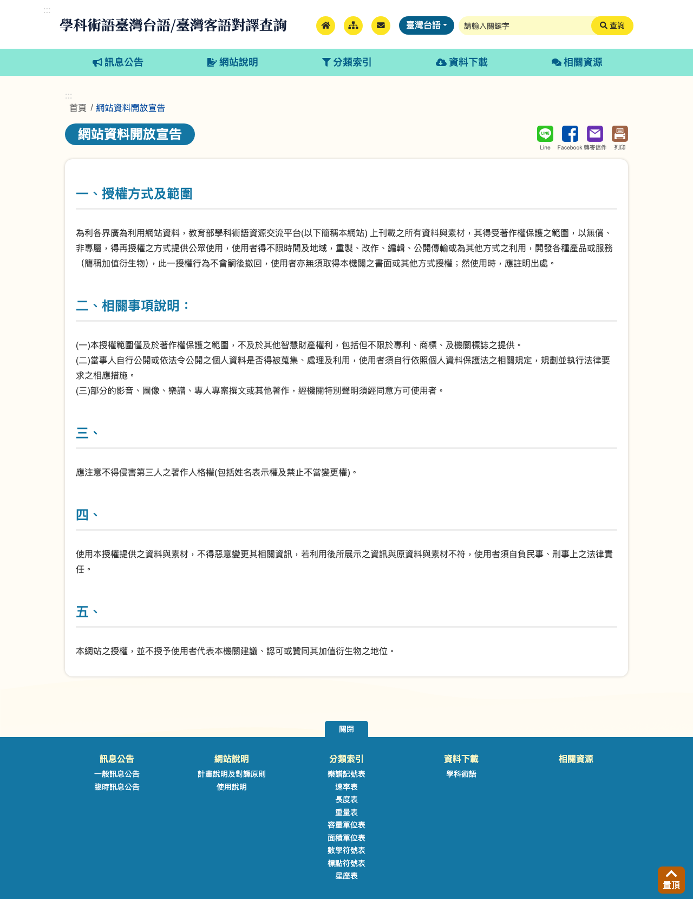

# KipHakkhoSutgiDataMirror

Data mirror for ChhoeTaigi KipHakkhoSutgi (教育部學科術語臺灣台語對譯). This site provides direct access to the subject terminology Taigi translation data published by the Taiwan Ministry of Education, converted to CSV and JSON. The files are hosted on GitHub Pages for easy access.

## Chu-liāu Pán-koân

網站資料開放宣告
- https://stti.moe.edu.tw/website-information-opening-announcement/?lang=sutgi
- 教育部學科術語資源交流平台上刊載之所有資料與素材，以無償、非專屬、得再授權之方式提供公眾使用，使用者得不限時間及地域，重製、改作、編輯、公開傳輸或為其他方式之利用；然使用時，應註明出處。

## Latest Version

* **Version ID:** `20261019-0058`
* **Last Updated:** 2026-10-19
* **Source File:** `ttg_20241219.ods`

You can check [**manifest.json**](./public/manifest.json) for the latest version information programmatically. Its `last_updated` is when the latest version directory was generated; `source_last_changed` is when the source file itself last changed. A regeneration after a converter change (e.g. a new column) moves only the former, so compare the file hash or `source_last_changed` to detect new terminology data.

## Accessing Files

The files are organized by version. The latest files are in `public/20261019-0058/`.

### Text Data (`bunji/`)

* [**KipHakkhoSutgiData.csv** (Terminology Data CSV)](./public/20261019-0058/bunji/KipHakkhoSutgiData.csv)
* [**KipHakkhoSutgiData.json** (Terminology Data JSON)](./public/20261019-0058/bunji/KipHakkhoSutgiData.json)
* **Base URL:** `https://chhoetaigi.github.io/KipHakkhoSutgiDataMirror/public/20261019-0058/bunji/`
* **Columns:** `編號, 中文, 中文解說, 分類, 臺灣台語詞彙(漢字), KPL, 網址`
* **`分類`:** the source's five columns `第1階段`–`第5階段` (each holding `學習領域-科目` lines) are merged into one column whose lines read `學習領域-學習階段-科目`, e.g. `社會-第1階段-生活課程`. A few source lines carry only the 學習領域; those read `學習領域-學習階段`.
* **`網址`:** direct link to the term's page on the source site, `https://stti.moe.edu.tw/search/search-result/{編號}/?lang=sutgi`, e.g. <https://stti.moe.edu.tw/search/search-result/100071/?lang=sutgi> for 三角形. Empty if `編號` is ever non-numeric.
* **Renamed columns:** `序號` → `編號`, `學科術語` → `中文`, `參考解釋` → `中文解說`, `臺灣台語詞彙` → `臺灣台語詞彙(漢字)`, `臺羅` → `KPL` (Kàu-io̍k Pō͘ Lô-má-jī, Tâi-lô).
* **Multi-value cells:** cells holding several lines in the source (e.g. several `KPL` readings) are kept as one string with `\n` between lines, in both CSV and JSON.
* **Rows:** 4,650 terms, one row per `編號`.

The original ODS (`tangloo/KipHakkhoSutgiData.ods`) is not committed to this repo. Download it from the source link below.

## Chu-liāu bāng-chí

資料下載
1. [學科術語 臺灣台語彙整檔（ttg_20241219.ods）](https://stti.moe.edu.tw/.galleries/file-download/ttg_20241219.ods)

Download page: <https://stti.moe.edu.tw/file-download/newsData/?lang=sutgi>

## Source

Original data source: 教育部 學科術語臺灣台語/臺灣客語對譯查詢 <https://stti.moe.edu.tw/>
